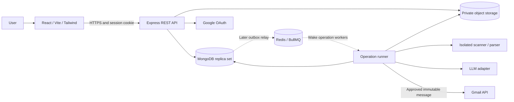

# HireReach AI architecture

Planning baseline: 2026-10-17. Foundation, session authentication and Phase 2 contact management are implemented. Other flows below remain the target architecture. Defaults below are application policy, not Google account quotas or legal guarantees.

## 1. System boundaries and major decisions

Use a JavaScript monorepo and a modular Express application. The API and operation runner share business services and models but run as separate processes. This keeps transactions and ownership rules centralized while allowing expensive parsing, LLM calls, and sending to run outside HTTP request lifetimes.



| Decision | Reason and consequence |
| --- | --- |
| Feature modules in one backend | Easier transactional consistency and deployment than independently deployed domain services |
| Opaque server-side sessions | Simple revocation and secure browser cookies; no browser-stored bearer tokens |
| Private object storage | Uploaded files stay out of MongoDB documents, web roots and ephemeral container disks |
| Immutable resume/email snapshots | Approval and attached evidence remain reproducible after later edits |
| MongoDB durable operations first | Restart-safe work without requiring Redis in the first release |
| Narrow Gmail send permission | Limits mailbox access; automatic inbox reconciliation and reply tracking are outside scope |
| Grounded structured LLM output | Resume evidence constrains factual claims; a prompt alone is insufficient |
| Conservative send ambiguity handling | Application deduplication cannot guarantee exactly-once Gmail delivery |

Use a replica set in development, integration tests and production because contact commits and future approval/dispatch transactions span documents. Standalone MongoDB does not support these transactions. [MongoDB transaction requirements](https://www.mongodb.com/docs/manual/core/transactions-production-consideration/)

## 2. Proposed folders

The initial setup uses `client/` and `server/` as requested for implementation, mapping the originally proposed `apps/web/` and `apps/api/` to these names. Internal feature/module boundaries remain unchanged. Foundation, auth, contacts and imports modules are present; the remaining folders below are future layout, not implemented features.

```text
hire-reach-ai/
  README.md  ARCHITECTURE.md  PLAN.md  AGENTS.md
  package.json                 # npm workspaces, shared scripts
  client/                      # frontend workspace; .env.example contains public settings
    src/
      app/                     # router, providers, protected layouts
      features/
        auth/ dashboard/ imports/ contacts/ resumes/
        campaigns/ emails/ integrations/ settings/
      components/              # reusable accessible UI
      lib/                     # API client, formatting, error mapping
      styles/                  # Tailwind entry and design tokens
    public/
    tests/
    vite.config.js
  server/                      # backend workspace; .env.example contains server settings
    src/
      app.js                   # Express composition, no listening side effects
      server.js                # startup, shutdown, health
      config/                  # validated server environment
      middleware/              # auth, CSRF, rate limits, errors, request IDs
      modules/
        auth/ users/ files/ imports/ contacts/ resumes/
        campaigns/ emails/ approvals/ integrations/
        delivery/ operations/ audit/
      adapters/                # gmail, llm, object storage, auth mail, scanner
      infrastructure/          # database, crypto, logger, clock
      runners/                 # MongoDB poller; later BullMQ worker/relay
      jobs/                    # cleanup, retention, operation recovery
    tests/                     # integration and contract tests
  packages/
    contracts/                 # JavaScript request/response schemas and enums
  tests/e2e/                   # Playwright and synthetic fixtures
  scripts/                     # index migrations and maintenance
  infra/                       # containers, local replica set, deploy templates
  docs/openapi.yaml            # implementation-time API specification
```

Each feature module may contain `*.routes.js`, `*.controller.js`, `*.service.js`, `*.repository.js`, `*.model.js`, `*.validation.js` and colocated tests as needed. Do not create empty layers for trivial behavior. Services own state transitions; controllers never call Gmail or the LLM directly. Adapters accept bounded inputs and return normalized errors.

Frontend routes: `/register`, `/login`, `/verify-email`, `/reset-password`, `/dashboard`, `/imports/:id`, `/contacts`, `/resumes`, `/campaigns`, `/campaigns/:id`, `/campaigns/:id/review`, `/settings`. Use a campaign wizard, paginated contact views, explicit row selection, mobile cards, and an email review screen showing recipient, sender, resume filename, subject and full body. Poll operation/status endpoints initially. Never imply approval through a preselected checkbox.

## 3. Core flows

### Contact import (implemented Phase 2)

This slice uses bounded HTTP requests and a short-lived parser child process. Parsed staging rows persist in MongoDB; original contact binaries are never stored or downloadable. Object storage, scanning services and durable operation runners remain future infrastructure. This avoids requiring a runner/storage deployment for a 5 MiB import while preserving explicit preview/commit and atomic persistence. A timed-out upload may leave a recoverable history entry; it never saves contacts. Resume uploads still require the planned storage/scanning path.

1. Authenticate and check same-origin CSRF before buffering one multipart `file`. Accept UTF-8 comma-delimited CSV, XLSX and legacy BIFF8 XLS, as explicitly requested for Phase 2. Limits: 5 MiB input, 5,000 data rows across at most 10 worksheets, 50 columns, 10,000 characters per cell and 8 MiB serialized staging data. Reject spoofed signatures, malformed input and oversized files. XLSX ZIP inspection limits expansion to 25 MiB and 1,000 entries, rejecting encryption, VBA, external links and embedded objects. XLS decoding rejects VBA/encryption/macro sheets. No formulas or hyperlinks are evaluated or fetched.
2. Parse in a child process with a 10-second deadline and 128 MiB V8 heap, a minimal environment without credentials, and Node permission restrictions allowing reads only from source/dependency locations. Filesystem writes, native addons and further child processes are not permitted. These are defense-in-depth controls, not an OS sandbox or RSS/network limit: production must add unprivileged containers, CPU/RSS limits and denied parser egress. Antivirus scanning is not implemented; original binaries are discarded and never served. Review this exception and legacy XLS parser risks before public deployment.
3. Treat the first nonempty row as headers. Suggest unambiguous aliases for `email`, `hrName`, `companyName`, `designation`; unknown/ambiguous headers require manual selection by column index. The user selects one worksheet. Only email is required; missing optional values remain empty. Preview accepts `expectedVersion`; remapping is allowed and invalidates the prior preview version.
4. Trim and NFC-normalize text, lowercase/IDNA-normalize email domains and preserve local-part spelling. Use lowercased `emailKey` for conservative deduplication; never strip dots or plus tags. Reject non-ASCII local parts, control characters, address lists and malformed addresses. Syntax checks do not prove mailbox deliverability; no DNS or SMTP probes run.
5. Classify each data row as exactly one of `valid`, `invalid`, `duplicate`, `skipped`. Completely empty rows are skipped. Reasons: `EMPTY_ROW`, `MISSING_EMAIL`, `INVALID_EMAIL_OR_FIELDS`, `FORMULA_CELL`, `DUPLICATE_IN_FILE`, `ALREADY_EXISTS`. A formula in any column rejects the row, including cached results. First valid occurrence wins; existing owned contacts, including archived contacts, are duplicates. Imports never overwrite existing records. Counts satisfy total = valid + invalid + duplicate + skipped; saved is the number inserted at commit.
6. Store staging rows separately from import metadata. Show paginated results, reasons and bounded mapped source values for invalid rows as escaped React text. Nothing enters canonical contacts before explicit `POST /commit`. Row access, preview and commit expire after 24 hours; metadata/history expires after 90 days. TTL indexes remove expired documents eventually; application checks enforce deadlines immediately.
7. Commit in a MongoDB transaction: acquire the owner's state-document write lock, reclassify against current contacts, insert only valid rows and record counts/status together. All contact edits, archives, restores, mapping and commits use this owner lock, serializing deduplication across API processes. Unique `(userId,emailKey)` is the database invariant. Competing imports can reduce final saved counts. Repeating a completed commit with its original expected version returns the original result; other stale versions return 409. Parsing happens outside transactions.

Limits: 120 contact requests/minute and 10 upload attempts/hour per owner in MongoDB buckets; five pending unexpired imports and 50,000 contacts (including archived) per owner. A supplementary two-upload process-local guard bounds simultaneous buffering/parser children; durable quotas apply across processes. Lists use bounded page pagination (25 default, 100 maximum, page <= 2,000) and stable ID ordering. Search escapes substring input across name/email/company and has a query deadline; company filtering is exact. Company choices show the first 200 sorted active companies; search remains available for others. Larger datasets should move to measured cursor/indexed search.

Deletion archives contacts and retains dedupe identity; restoration is a versioned edit. Selection is browser memory only and grants no campaign or send approval. Rejection export, suppression management, import-history deletion and binary downloads remain deferred.

Phase 2 verification includes database-backed CSV/XLSX import and persistence, concurrent duplicate prevention, replay safety, owner isolation, and a gated browser-to-live-API flow using synthetic users and a local isolated replica set. This evidence does not certify Atlas connectivity or production deployment; parser OS containment, physical TTL timing, load/failover, backups and deletion drills remain release gates. See README.md for the reproducible test commands and current check results.

### Resume and generation

Upload a PDF up to 5 MiB and 20 pages, inspect/scan it, and extract text with page/character offsets under resource limits. Reject encrypted, invalid or image-only PDFs with an actionable message; OCR is deferred. Store every upload as an immutable version with a SHA-256 content hash. The user reviews extracted facts against the PDF before generation. Extraction corrections must preserve source evidence; new qualifications require a new resume.

Create a campaign with a ready resume version, selected valid contacts and a desired role. The role expresses intent, never evidence of experience. Freeze contact snapshots per campaign email, and send only necessary resume facts, company/HR labels and desired role to the LLM. No browsing, company enrichment or inferred company achievements.

The LLM returns bounded structured selections of fact IDs, evidence spans and approved template choices. Validate facts against exact source spans and construct candidate factual clauses from verified values through a controlled renderer. Do not allow free-form LLM claims about skills, employers, tenure, metrics, certifications or accomplishments. Unsupported or invalid output becomes `needs_review`; a second LLM's opinion does not establish truth. Select an LLM/provider offering suitable retention and training controls before production.

Show provenance alongside the draft. Editing or regeneration increments `contentVersion` and clears approval; apply generation output only if the input version still matches. User-authored edits are labeled and require renewed review of factual statements against the resume. Human mistakes and ambiguous extraction remain possible; do not claim a universal truth guarantee. If arbitrary prose is later introduced, it needs an additional groundedness evaluation before replacing the constrained generation contract.

### Gmail connection

Application registration/login is separate from Gmail authorization. Use backend authorization-code exchange, exact HTTPS redirect URIs, a cryptographically random single-use state bound to user/session and expiring after 10 minutes, and an OIDC nonce. Request `openid email` to identify the selected account and `https://www.googleapis.com/auth/gmail.send` for sending. Validate ID-token signature, issuer, audience, expiry, nonce and verified email; bind by Google `sub`, not a browser-supplied address. Use PKCE if supported by the selected Google web-client flow/library and verify that integration during milestone 8.

Request offline access; store refresh grants encrypted on the backend. Preserve an existing refresh token when a same-account refresh response omits it; otherwise require reconnect. Keep access tokens short-lived and server-side. State prevents callback CSRF; a normal session CSRF check protects starting/disconnecting the integration. [Google web-server OAuth flow](https://developers.google.com/identity/protocols/oauth2/web-server)

Use send-only scope rather than Gmail draft/read scopes; store draft text in HireReach. Google classifies `gmail.send` as sensitive, so public release must address applicable OAuth verification. [Gmail scope reference](https://developers.google.com/workspace/gmail/api/auth/scopes)

One active Gmail connection per user initially. The `From` address is the verified connected address; arbitrary aliases are out of scope. Changing account identity invalidates pending approvals; routine token refresh does not. Disconnect disables dispatch immediately, cancels unclaimed operations, revokes the grant where possible and deletes local tokens; an already-started request may finish.

## 4. MongoDB model design

All domain documents have `_id: ObjectId`, timestamps and explicit `schemaVersion`. Mutable resources also have a numeric `version` incremented by compare-and-set updates; email content additionally uses `contentVersion`. User-owned documents include immutable `userId`; references use ObjectIds and are always checked for matching ownership by services. Dates use UTC. Strings, arrays and nested JSON have maximum lengths. Sensitive fields are excluded from normal projections; exclusion alone is not authorization. Store binary files in object storage, never in these documents.

`U(...)` denotes a unique index. Indexes beginning with `userId` support tenant-scoped access. Apply indexes through migrations; Mongoose validation supplements, but does not replace, database constraints.

| Collection | Main fields and invariants | Required indexes |
| --- | --- | --- |
| `users` | `email`, `emailKey`, `passwordHash`, `displayName`, `emailVerifiedAt`, `status: active/deleting/disabled`, `timezone`, `preferences` | `U(emailKey)` |
| `sessions` | `userId`, `tokenHash`, `csrfSecret`, `expiresAt`, `lastSeenAt`; opaque cookie contains only a random token | `U(tokenHash)`, TTL `expiresAt`, `(userId)` |
| `authTokens` | `userId`, `purpose: verify/reset`, `tokenHash`, `expiresAt`, `usedAt`; single-use, hashed at rest | `U(tokenHash)`, TTL `expiresAt` |
| `oauthStates` | `userId`, `sessionId`, `stateHash`, `nonceHash`, optional encrypted PKCE verifier, `expiresAt`, `usedAt` | `U(stateHash)`, TTL `expiresAt` |
| `files` | `userId`, `kind: contact_source/resume`, random `objectKey`, safe display name, detected MIME, bytes, `sha256`, `scanStatus`, `expiresAt`, `deletedAt` | `U(objectKey)`, `(userId,createdAt)`, `(expiresAt)` |
| `contactImports` | userId, safe filename, SHA-256/bytes, bounded worksheet/column metadata, sheet, mapping, status=mapping/preview/completed, total/valid/invalid/duplicate/skipped/saved counts, version, committedVersion/time, previewExpiresAt, expiresAt | `(userId,_id)`, TTL expiresAt (90 days) |
| `importRows` | userId, importId, sheet, rowNumber, bounded cells/formulaColumns, cleaned values, status=unmapped/valid/invalid/duplicate/skipped, reason, expiresAt | `U(userId,importId,sheet,rowNumber)`, owner/import/sheet/status/row, TTL expiresAt (24 hours) |
| `contacts` | userId, email/emailKey, optional companyName/hrName/designation, sourceImportId/sourceRow, archivedAt, version, schemaVersion, timestamps | `U(userId,emailKey)`, owner/archive/ID, owner/company, owner/source indexes |
| `contactOwnerStates` | userId, revision; transaction serialization guard without contact content | `U(userId)` |
| `suppressions` | `userId`, `recipientKey` (keyed hash of dedupe address), `reason`, `source: user/admin`, `createdAt`; checked independently of contact existence | `U(userId,recipientKey)` |
| `resumes` | `userId`, `fileId`, `versionLabel`, `sha256`, bounded extracted text, bounded `facts[{id,type,value,page,start,end}]`, `factsHash`, `reviewedAt`, `status: processing/needs_review/ready/rejected`, error | `(userId,createdAt)` |
| `gmailConnections` | `userId`, `googleSub`, verified email, granted scopes, encrypted refresh token envelope (`ciphertext`, nonce, tag, key version), `identityVersion`, `status: connected/reconnect_required/disconnected` | `U(userId)`, partial `U(googleSub)` while linked |
| `campaigns` | `userId`, name, desired role, `resumeId`, `status: draft/active/paused/completed/archived`, optional cached counts; no embedded contact list | `(userId,createdAt)`, `(userId,status)` |
| `emails` | `userId`, `campaignId`, `contactId`, recipient/company/HR snapshot, `emailKey`, `resumeId`, subject, plain-text body, evidence references, `generationMetadata`, `contentVersion`, `contentHash`, `status`, `currentApprovalId` | `U(userId,campaignId,emailKey)`, `(userId,campaignId,status,createdAt)` |
| `approvals` | `userId`, `emailId`, `contentVersion`, immutable exact snapshot (recipient/sender/subject/body/resume hash and filename/account identity), `snapshotHash`, `approvedAt`, `expiresAt`, `revokedAt`, `consumedAt`; one record per selected email | `(userId,emailId,contentVersion)`, `(expiresAt)`; current approval selected by email CAS |
| `deliveries` | `userId`, `emailId`, `currentAttemptId`, `operationId`, `status: pending/dispatching/submitted/failed/unknown/cancelled`, lease/fence fields, `dispatchStartedAt`, `gmailMessageId`, `submittedAt`, sanitized error | `U(emailId)`, `(userId,status,createdAt)`, `(status,leaseUntil)` |
| `sendAttempts` | `userId`, `deliveryId`, monotonic `attemptNumber`, `approvalId`, immutable approved snapshot/hash, stable `messageId`, outcome, started/finished times, provider code/request ID; no token or full provider payload | `U(deliveryId,attemptNumber)`, `(userId,deliveryId)` |
| `recipientGuards` | `userId`, `recipientKey`, `activeDeliveryId`, `lastSubmittedAt`, `blockedUnknown`; serializes cross-campaign recipient sends and enforces cooldown | `U(userId,recipientKey)` |
| `mailboxControls` | Keyed `mailboxKey` from Google subject, `activeDeliveryId`, dispatch fence, `nextAllowedAt`, `blockedUnknown`; persists across reconnect and day boundaries | `U(mailboxKey)` |
| `quotaBuckets` | `scopeKey` (user or keyed mailbox subject), `utcDate`, reserved/consumed counts; reservation accounting is transactional | `U(scopeKey,utcDate)` |
| `operations` | `userId`, `type: import/parse_resume/generate/send/delete_account`, resource IDs, `status: pending/running/succeeded/failed/cancelled/needs_attention`, bounded progress, lease/fence, attempt count, `availableAt`, sanitized error; later `publishPending` | `(status,availableAt,leaseUntil)`, `(userId,createdAt)` |
| `idempotencyRecords` | `userId`, route scope, key hash, request hash, resulting resource/operation IDs, `expiresAt`; different payload under same key is a conflict | `U(userId,scope,keyHash)`, TTL `expiresAt` |
| `auditEvents` | `userId`, actor ID/type, action, resource IDs, timestamp, request ID, version/hash and outcome; append-only via application permissions, no full content | `(userId,createdAt)`, `(resourceId,createdAt)` |

Relationships: a user owns imports, contacts, resumes, campaigns and one Gmail connection; an import has many rows; saved contacts reference their source import/row (which may expire without deleting contacts); a campaign references one immutable resume and has many emails; each email references a contact snapshot, many approval versions and one logical delivery; a delivery has many attempts. Operations reference resources rather than embedding all results. Database references do not cascade automatically: explicit deletion services own cleanup.

Campaign role/resume changes are allowed only in `draft`, invalidate all affected generation/approvals and increment email versions transactionally in bounded batches while the campaign is locked for editing. After activation, create a new campaign for another role/resume. Contact edits never mutate historical snapshots; refreshing an unsent email from a contact is an explicit versioned action.

## 5. Approval, dispatch and recovery

### State and approval contract

Email states: `pending_generation -> generating -> needs_review -> approved -> pending_send -> sending -> submitted | failed | unknown`. Generation failures return to `needs_review` with an error. Cancelling an unclaimed send returns the email to `needs_review`; successful edits/revocation also return to review. `submitted` and `unknown` cannot be sent again. A `failed` email may be reapproved only if the prior attempt is known not to have been accepted. Submitted content is immutable.

Approval is an authenticated explicit action on selected IDs and expected versions, maximum 25 at a time. The backend revalidates readiness and ownership, computes a canonical SHA-256 snapshot hash and writes approvals plus audit events atomically. An approval expires after 24 hours. Relevant content includes recipient, verified sender/account identity version, subject, full rendered plain-text body, resume ID/hash and attachment filename. Approval never relies on a client-supplied hash or `approved: true` flag.

The user then requests sending the selected approved items. Editing any covered field invalidates approval; pending sends must first be cancelled, and dispatching content cannot be edited. Race prevention uses state/version compare-and-set and transactions, not UI disabling. UI must show all selected recipients and exact content before approval; a campaign-level approval does not approve future emails.

### Dispatch algorithm

1. The send API requires `Idempotency-Key`, selected email/approval IDs and expected versions. In one short transaction, check eligibility, create/reuse one logical delivery per email, consume each approval for this request, create an attempt with an immutable approved snapshot, create pending operations and write request-deduplication records. Reuse after cancellation or definitive failure allocates a new numbered attempt under a fresh approval; historical attempts never change content. Any invalid item rejects the bounded batch; no partial enqueue.
2. The initial MongoDB runner polls and atomically leases pending operations. Use one active dispatch per mailbox plus durable pacing; more runners cannot bypass guards. Before an external call, recheck account/campaign state, snapshot integrity, attachment availability/hash, approval expiry/revocation, suppression, recipient cooldown and user/mailbox quotas.
3. In a transaction, acquire recipient and mailbox guards, reserve quota and transition the delivery to `dispatching` with a unique fencing token and dispatch timestamp. This is the cancellation boundary; send-disable and cancellation stop unclaimed work, but cannot retract an in-flight request. Never hold a MongoDB transaction across network calls.
4. Build a single-recipient MIME message from the immutable snapshot, attach the exact approved PDF, and submit once. Disable automatic transport retries for send. Use a stable RFC Message-ID for investigation; it is not a Gmail idempotency guarantee. Gmail accepts MIME in base64url form via `users.messages.send`. [Gmail sending guide](https://developers.google.com/workspace/gmail/api/guides/sending)
5. Record provider success as `submitted` with Gmail message ID and commit counters/audit data. A definitive rejection becomes `failed`, releases active guards, and may be explicitly reapproved after repair. Timeout, connection loss after dispatch, ambiguous 5xx, or a crash after dispatch begins becomes `unknown`, retains guards and conservatively consumes quota. A stalled dispatch is never assigned to another sender.
6. On restart, safely resume operations that have not crossed the dispatch boundary; mark stale dispatches unknown. A late successful response from the original attempt may settle unknown to submitted using the matching attempt/fence. Do not create a new attempt while that outcome is unknown. Show the user the timestamp, recipient and Message-ID for manual Sent-folder inspection; no automatic resend or read-scope escalation. An unknown attempt also holds the mailbox until a late result arrives or an operator verifies the original worker has stopped and releases only the mailbox hold with an audit event. The recipient remains blocked; manual inspection cannot authorize an automatic retry.

Pending operations delayed by pacing or daily caps receive `availableAt` and remain visible. Expired/revoked approval cancels unclaimed work and requires new approval; paused campaigns cannot dispatch. Safe parsing/generation retries are bounded (three attempts with jittered backoff). Operation status reports `needs_attention` for ambiguous sends. Approval creation requires a reviewable email state and a version match, so replay cannot silently replace an already consumed approval.

The Gmail send method exposes no documented application idempotency key. The resulting design deliberately sacrifices automatic retry when acceptance is uncertain. [Gmail send contract](https://developers.google.com/workspace/gmail/api/reference/rest/v1/users.messages/send)

### Duplicate and volume policy

- At most one logical delivery per campaign email; a submitted email cannot be resent in that campaign. HTTP idempotency records last 7 days; persistent delivery uniqueness outlives them.
- Block a recipient across campaigns for 30 days after submission; unresolved unknown outcomes remain blocked. Archived/deleted contacts do not clear guards or suppressions. Case-folded dedupe can produce false positives, which is preferable to accidental double sending in this MVP.
- Default caps: 25 approved items per batch, 50 submissions per UTC day per user and connected mailbox, and at least 60 seconds between mailbox dispatch starts. Enforce both user and mailbox buckets transactionally, including reservations; reconnecting cannot reset the day's budget. Only deployment operators can lower/raise bounded policy, not untrusted request fields.
- Reservations started before UTC midnight count against that start day's cap. Keep quota reserved through uncertain dispatch; release only on verified non-acceptance. Campaign pause, revoked grants, suppression and a global `SEND_ENABLED=false` gate stop new dispatches.
- App caps do not replace provider limits. Honor explicit rate-limit errors and Retry-After guidance, but only retry a send after non-acceptance is established and the user renews approval. Backoff for safe reads/generation is separate. [Gmail error guidance](https://developers.google.com/workspace/gmail/api/guides/handle-errors)
- Limit signup/login, upload, generation and OAuth endpoints separately. Require verified app email before generation or sending; apply per-user LLM budgets and an operator abuse-disable control. Suppression is checked at approval and dispatch.

Campaign counts are derived from emails/deliveries; cached counters are repairable projections. `submitted` means accepted by Gmail, not delivered to an inbox. Opens, bounces and replies are not measured in the initial release.

### Later Redis/BullMQ phase

Keep MongoDB operation creation transactional with business state. A relay publishes pending operation IDs to BullMQ and then marks publication; crashes may publish duplicates, so workers check MongoDB state and claim using fencing. A periodic sweeper republishes eligible unfinished operations after queue loss. Redis is scheduling infrastructure, not approval or delivery authority. Queue retries are safe for parsing/generation with version checks; send workers obey the same unknown-outcome rule. Queue payloads contain IDs, not resumes or OAuth tokens.

## 6. REST API contract

Base path `/api/v1`; JSON except multipart uploads, file downloads and OAuth redirects. Use validated request schemas, reject unknown mutation fields and validate ObjectIds. All routes require the current user's session and ownership except CSRF-token issuance, registration/login, verification/reset submission and health endpoints. OAuth callback requires valid stored state and its bound session. Browser mutations require CSRF tokens and Origin checks; OAuth callback uses single-use state instead.

Implemented contact lists return `{ data, meta: { total, page, limit, pages } }`; other resources plan `{ data, meta?: { nextCursor } }`. Error: `{ error: { code, message, fields? }, requestId }`; sanitized and stable. Use 201 for creation, 202 with operation ID for asynchronous work, 204 for deletion/logout, 400 malformed input, 401 unauthenticated, 403 unverified/CSRF, 404 absent or foreign resources, 409 version/state/idempotency conflict, 413 size, 415 type, 422 semantic invalidity and 429 limits with retry guidance. Future list endpoints accept opaque `cursor` and `limit` (default 25, maximum 100), with allowlisted filters/sorts. Never return provider tokens or stack traces.

| Method and path | Input / result and behavior |
| --- | --- |
| `GET /auth/csrf` | Issue session-bound CSRF token in JSON and a pre-login session cookie |
| `POST /auth/register` | Email, password, display name; Argon2id hash, normalized unique email, generic success for new and duplicate accounts; email verification is a later scope |
| `POST /auth/login` | Email/password; generic credential error; rotate session and set cookie |
| `POST /auth/logout` | Revoke current server-side session and clear cookie |
| `GET /auth/me` | Safe authenticated user profile |
| `POST /auth/verify-email` | Consume single-use verification token |
| `POST /auth/resend-verification` | Generic response; strict throttling |
| `POST /auth/forgot-password` | Email; generic response regardless of account existence |
| `POST /auth/reset-password` | Token/new password; invalidate sessions |
| `PATCH /users/me` | Display name/timezone/preferences only |
| `DELETE /users/me` | Recent password reauthentication; disable access and start account deletion operation |
| `POST /contact-imports` | Multipart file; 201 staged import, worksheet columns and suggested mapping |
| `GET /contact-imports` | Paginated 90-day history |
| `GET /contact-imports/:id` | Worksheet/header metadata, mapping, counts and expiry |
| `POST /contact-imports/:id/preview` | Worksheet, mapping indices, expectedVersion; 200 counts/version; no contacts saved |
| `POST /contact-imports/:id/commit` | expectedVersion; 200 final counts; replay returns completed result for the committed preview version |
| `GET /contact-imports/:id/rows` | status=all/valid/invalid/duplicate/skipped; page/limit |
| `GET /contacts` | search, company, status=active/archived/all, importId, page/limit |
| `GET /contacts/statistics` | Active/archived totals, company choices, 90-day import/saved/duplicate totals |
| `PATCH /contacts/:id` | expectedVersion, email, optional names/designation and archived; revalidate/deduplicate |
| `DELETE /contacts/:id` | expectedVersion; archive and retain dedupe identity |
| `GET /suppressions` | Paginated blocked recipients |
| `POST /suppressions` | Email/reason; create suppression without needing a contact |
| `DELETE /suppressions/:id` | Remove user suppression; does not clear cooldown/unknown guard |
| `POST /resumes` | Multipart PDF; 202 resume and parse-operation IDs |
| `GET /resumes` | Version history and readiness |
| `GET /resumes/:id` | Extracted facts/evidence and status |
| `POST /resumes/:id/review` | Expected facts hash and explicit confirmation; mark source-backed facts reviewed |
| `GET /resumes/:id/download` | Authorized attachment download; short-lived signed access or streamed file |
| `DELETE /resumes/:id` | Reject with 409 if referenced by an active campaign/pending send; otherwise archive and schedule policy-based purge |
| `POST /campaigns` | Name, desired role, owned ready resume ID; create draft campaign |
| `GET /campaigns` | Paginated campaign summaries |
| `GET /campaigns/:id` | Configuration and derived counts |
| `PATCH /campaigns/:id` | Expected version; draft configuration or allowed activate/pause/archive transition |
| `POST /campaigns/:id/contacts` | Up to 100 contact IDs; add unique email placeholders (campaign cap 5,000) |
| `DELETE /campaigns/:id/contacts/:contactId` | Remove only membership with no dispatch history; cancel/revoke pending work first |
| `POST /campaigns/:id/generations` | Selected email IDs, up to 25, expected versions; idempotency key; 202 operation |
| `GET /campaigns/:id/emails` | Paginated drafts/status filters |
| `GET /emails/:id` | Full draft, evidence, current version, approval and delivery summary |
| `PATCH /emails/:id` | Expected version plus subject/body or explicit contact refresh; invalidate approval |
| `POST /campaigns/:id/approvals` | Selected email IDs/versions and explicit confirmation; atomic immutable approvals |
| `POST /approvals/:id/revoke` | Revoke approval and cancel unclaimed dispatch; 409 once dispatch begins |
| `POST /campaigns/:id/send` | Selected email/approval IDs/versions; required idempotency key; 202 operation IDs |
| `GET /deliveries/:id` | Immutable snapshot, sanitized attempts and outcome |
| `POST /deliveries/:id/cancel` | Cancel only before dispatch boundary; revoke consumed approval |
| `GET /integrations/gmail` | Safe connection identity, granted capability, reconnect status |
| `POST /integrations/gmail/authorize` | Return allowlisted Google authorization URL with bound state |
| `GET /integrations/gmail/callback` | Validate state/code/OIDC; redirect to fixed frontend result page |
| `DELETE /integrations/gmail` | Disable connection, revoke grant and cancel unclaimed sends |
| `GET /operations/:id` | Progress/status/error; no provider secrets |
| `GET /dashboard` | Tenant-scoped campaign, submitted, failed and unknown counts |
| `GET /audit-events` | Paginated user's activity timeline |
| `GET /health/live`, `GET /health/ready` | Minimal liveness/dependency readiness; no sensitive diagnostics |

All versioned mutations use `expectedVersion` in the body; mismatch is 409. Collection rows expose their versions; email review/approval additionally binds `contentVersion`. Contact preview/commit use version-based replay semantics described above; mandatory idempotency keys apply to future generation and sending; request hashing includes sorted resource IDs and versions. Replaying the same key/payload returns the original operation/resource IDs; a different payload returns 409. Authenticate and authorize replays just like new requests. Retryable failed emails use the normal review, approval and send endpoints; no endpoint bypasses approval.

## 7. Security, privacy and deployment

### Identity and data boundaries

- Hash passwords with Argon2id, benchmark parameters at implementation, allow long passphrases and impose a bounded input size. Use generic auth responses and shared durable throttles. Verification/reset tokens are random, hashed, expiring and single-use; no tokens in application logs.
- Use a `__Host-` Secure, HttpOnly, SameSite=Lax cookie with Path=/ and no Domain in production. Rotate at login; idle expiry 24 hours, absolute expiry 7 days. Validate expiry in application code because TTL deletion is asynchronous. Use CSRF tokens and strict same-origin policy for mutations. Serve web and API through one origin; local Vite uses an API proxy.
- Authentication implementation currently uses the policy above; development/test HTTP uses a non-Secure cookie for local operation. Email verification, password reset and account settings are not part of the initial authentication implementation and must not be treated as implemented capabilities.
- Never trust `userId` from requests. Validate ownership for every referenced contact, import, resume, campaign, operation and attachment. Enforce limits on fields/arrays and allowlist MongoDB query construction to prevent operator injection and mass assignment.
- Use TLS, a restrictive CSP, secure headers and text-only email rendering. Never render imported strings or email bodies through unsafe HTML. Reject CR/LF in header fields; construct MIME with a maintained library. Download uploads as attachments from private storage with short-lived access and safe filenames.
- Encrypt refresh grants using authenticated encryption and managed key rotation; store key version with ciphertext. Use storage/database encryption at rest. Workers get only required service credentials. Keep auth-mail delivery separate from user Gmail outreach and enforce a fixed auth-mail template/recipient.
- Future retained file/resume uploads require quarantine/scanning and controlled parser egress. Phase 2's bounded, non-retained contact-binary exception and its deployment controls are documented above. Do not claim an antivirus scan or OS sandbox has run.

### Data lifecycle and observability

Implemented contact retention: original binaries are never persisted; staged rows expire 24 hours after upload, import history expires after 90 days, and contacts/owner-state persist until account deletion (contact deletion currently archives). TTL cleanup is asynchronous; expired previews cannot be read or committed. Future retained/quarantined files expire within 24 hours; session/token data until expiry; inactive operation details 30 days; audit events and completed campaign content 90 days after completion/archive. Active resumes persist until deletion; unreferenced archived versions purge after 30 days. Referenced resume PDFs stay available through pending dispatch and retained send-history periods. Retention deadlines are explicit fields/jobs, not blanket TTL on linked domain documents.

Keep minimal dedupe metadata (keyed recipient hash, delivery outcome, cooldown date) while the account exists so content cleanup cannot enable duplicate sending; unknown guards persist until account deletion. Clearly disclose this separately from content retention. Suppression persists until removed by the user or account deletion. Purge storage objects before deleting their metadata, using retryable deletion jobs and orphan reconciliation.

Account deletion immediately disables sends and sessions, revokes OAuth access, then purges live personal data within 30 days. Backups expire within a proposed 35-day window; a restored backup must reapply deletion tombstones and suppress sending until reconciliation completes. Final timelines and region must be reflected in published privacy terms before launch. LLM processing requires clear user disclosure; minimize third-party payloads and select suitable provider retention/training settings.

Log request/operation IDs, timing, error categories and state transitions, with email addresses and content redacted. Track operation age, generation failure/cost, OAuth refresh failures, quota blocks, unknown sends and scanner failures. Alert on stalled operations, unusual send rates and missing storage objects. Restrict access to administrative diagnostics and backups.

### Runtime configuration

Server configuration will include `NODE_ENV`, `PORT`, `APP_ORIGIN`, `MONGODB_URI`, `SESSION_SECRET`, `GOOGLE_CLIENT_ID`, `GOOGLE_CLIENT_SECRET`, `GOOGLE_REDIRECT_URI`, `TOKEN_ENCRYPTION_KEY_ID`, `RECIPIENT_HASH_KEY`, `LLM_PROVIDER`, `LLM_API_KEY`, `LLM_MODEL`, `STORAGE_BUCKET`, `STORAGE_REGION`, `AUTH_MAIL_PROVIDER`, `AUTH_MAIL_API_KEY`, `AUTH_MAIL_FROM`, `SEND_ENABLED`, upload/generation/send limits, and later `REDIS_URL`. Add provider-specific endpoints and credentials only when selected. Use workload identity where supported; inject required secrets from a secret manager through the environment, never commit them. A local-only encryption key can be supplied through a server environment variable; production uses a managed key service.

The frontend may receive public settings such as `VITE_API_BASE_URL`; all Vite-exposed values are public. Validate required configuration at startup, refuse unsafe production defaults, and ship `.env.example` with placeholders during scaffolding. Default all development/test environments to fake providers and disabled real sending.

### Deployment and operational decisions

- Pin a supported Node.js LTS and maintained dependency versions during implementation. Build the Vite SPA for static hosting behind the same HTTPS origin as `/api`; route OAuth callbacks to the backend and SPA paths to the frontend.
- Run separate unprivileged API and runner containers from the same application image, with bounded CPU/memory, read-only root filesystems where practical and ephemeral scratch directories. Use managed MongoDB replica-set hosting and a private encrypted object bucket in the selected data region. Redis is added only in milestone 13.
- Use separate development/staging/production databases, buckets, Google projects and credentials. CI has fake provider credentials; a staging real-send allowlist is additional protection, never a substitute for explicit approval.
- Configure trusted proxies explicitly, request/body/time limits, controlled egress and private database connectivity. Health checks distinguish live from ready; graceful shutdown stops new claims and preserves uncertain dispatch state.
- Run reviewed index/schema migrations before enabling new behavior. Use additive migrations and backwards-compatible rollbacks; start recovered environments with sending disabled. Backups must include database and file objects; test restoration and approval/delivery consistency together.
- Initial operating targets: daily backups, proposed RPO 24 hours and RTO 4 hours, verified by restore drills before launch. These are targets, not achieved guarantees. Assign monitoring/on-call ownership and a runbook for revoked grants, quota exhaustion, stuck operations, unknown sends, key rotation and emergency send disable.
- Before public launch, finish Google consent configuration/verification appropriate to the selected scopes, publish privacy/retention terms and acceptable-use rules, and review applicable outreach requirements for the operating region. No technical limit alone establishes regulatory compliance.

The production release gate is milestone 12 in PLAN.md. Redis improves scheduling later; it does not change approval, privacy or delivery guarantees.
